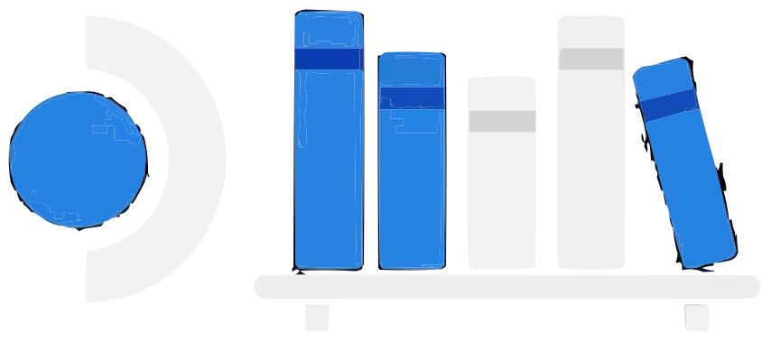
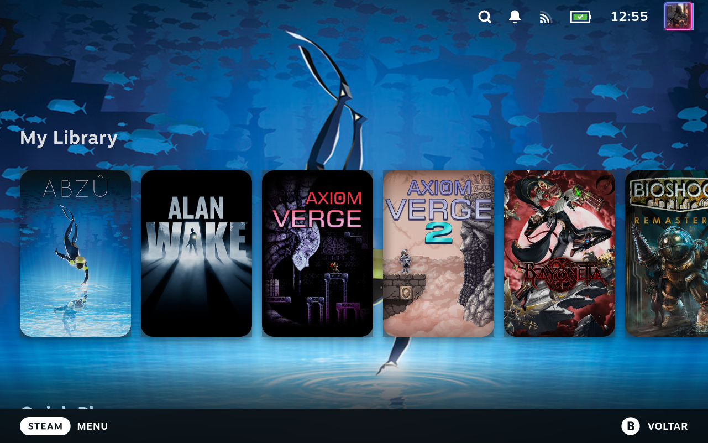

# Deck Shelves

<div align="center">
<p>
  
</p>

[](https://github.com/santojon/Deck-Shelves/actions/workflows/ci.yml)
[](https://github.com/santojon/Deck-Shelves/actions/workflows/release.yml)
[](tsconfig.json)
[](scripts/build/validate-compat.mjs)
[](https://github.com/ValveSoftware/SteamOS)
[](https://github.com/santojon/Deck-Shelves/releases/latest)
[](https://github.com/santojon/Deck-Shelves/releases/latest)
[](https://www.npmjs.com/package/@deck-shelves/api)
[](https://www.npmjs.com/package/@deck-shelves/host)
[](https://github.com/santojon/Deck-Shelves/network/members)

[](https://discord.gg/EChuVEDakk)
[](https://www.reddit.com/r/DeckShelves/)
[](https://github.com/sponsors/santojon)
[](https://ko-fi.com/santojon)

</div>

Deck Shelves is a [Decky Loader](https://decky.xyz) plugin that adds your own
shelves to the Steam Deck Home screen, below (or instead of) Recently Played.
A shelf can show a collection, a library tab, the result of a filter, your
wishlist or a store list. Everything is set up from the Quick Access menu in
Gaming Mode; you never need Desktop Mode or a config file.

New to it? The [getting-started guide](https://github.com/santojon/Deck-Shelves/discussions/48)
walks through the first shelves. Questions and ideas go to the
[Discord](https://discord.gg/EChuVEDakk) or [r/DeckShelves](https://www.reddit.com/r/DeckShelves/).

<p align="center">
  
</p>

## Contents

- [Features](#features)
- [Installation](#installation)
- [Limitations](#limitations)
- [Privacy](#privacy)
- [Documentation](#documentation)
- [Compatibility](#compatibility)
- [Contributing](#contributing)
- [License](#license)
- [About](#about)

## Features

### Shelves

- **Sources**: a collection, a library tab (including tabs other plugins
  create), a filter, built-in lists (pinned games, play history, queues,
  dynamic collections), or, with online features on, your wishlist or a Steam
  store list.
- **Several sources in one shelf**, combined as union (games in any source),
  intersection (games in every source) or source order (one source after the
  other, each with its own sort).
- **Templates**: 15 standard and 4 online presets, plus setup packs that add a
  whole starting set at once and can be undone. Nothing is saved until you
  press Save. See [shelf templates](docs/shelf-templates.md).
- **Decoration cards** at fixed positions in a row: a text label, an image
  (optionally used as the shelf's hero art), a link, or an empty gap.
- **Per-shelf control**: up to 50 cards, hide specific games (the shelf fetches
  more to keep the count), collapse duplicates by exact name, sub-filters on
  top of a collection or tab.
- **"Add to shelf"** in every game's menu, on the plugin's shelves and in the
  Steam library.

### Filters and sorting

- Filter groups with AND / OR logic, nestable, and any condition can be
  negated. Conditions cover install and favorite state, name (text or regex),
  app type, download state, Deck / SteamOS compatibility, playtime and last
  played, store tags, Steam features, genres, review score, release and
  purchase date, achievements, friends who own or play a game, Family Sharing,
  Remote Play, discount and price. Full list in [filters](docs/filters.md).
- Sorts by name, recent play, playtime, release date, size, Metacritic, review
  score, discount, price and more, each reversible, with tiebreaker keys.
- Saved filters you can apply to any shelf.
- TabMaster tabs import as shelves, each filter mapped to the matching condition.

### Smart shelves

Shelves that fill themselves from your library and only appear when they have
something to show: Daily Pick, Not Started, Quick Play, Interrupted,
Rediscover, Backlog Rescue, Hidden Gems, Travel Mode, Almost Finished, Co-op
Ready, Friends Playing and about 20 more. Each has tunable parameters, a
refresh interval and an optional time window. **Surprise Me** picks one to
five of them each day for you. See [smart shelves](docs/smart-shelves.md).

### When a shelf shows

- **Visibility rules**: show a shelf only at certain hours, days, parts of
  the day or seasons; on low battery, while charging, offline or docked; when
  a game is running; or under high CPU, low memory or low frame rate. Rules
  combine with *match all* or *match any*, and re-evaluate on events, not by
  polling.
- **Auto-pin** a shelf to the top, or **auto-collapse** it to its header,
  while a rule holds.

### Look

- Cards match Steam's native size, including sizes set by themes.
- Featured (landscape) first card or every card, per shelf or globally.
- Hero background art per shelf or for all shelves.
- Toggles for the status line, game names, badges, compatibility icons, shelf
  titles and the trailing "See more" / "Refresh" cards, per shelf or globally.
- Hide Steam's Recently Played row and the Home tab bar, or let your first
  shelf take over the Recents row with Steam's own tiles (experimental).
- [CSS Loader](https://github.com/DeckThemes/SDH-CssLoader) themes such as
  ArtHero, TiltedHome, Switch Like Home and Obsidian apply to the shelves too.
- **Light mode** strips the Home and the panels down to the essentials;
  **Advanced mode** adds diagnostics, snapshots and logs.

### Navigation and input

- **Quick Search** (L1+R1 on a card): fuzzy search across every game on your
  shelves, diacritics ignored (café ⇄ cafe).
- **Side Nav** (L1 twice): a list of your shelves; pick one to jump to it.
- **Y on a card** toggles its highlight.
- Every shortcut can be remapped or turned off, on the gamepad (single
  buttons, chords, double taps, back grips) and on the keyboard, separately.
- Mouse and touch work: hover, drag to reorder.

### Profiles and backup

- **Profiles** save your settings (and, if you choose, your shelves) under a
  name. Switch in one tap, or let a profile switch itself on a trigger (dock
  the device, battery runs low).
- **Per Steam account**: on a shared device each account keeps its own
  shelves and profiles.
- **Snapshots** before every profile switch, import and account change,
  restorable from Settings → Backup. Import and export as JSON.
- **Sync across devices** on the same Steam account through Steam's own
  storage (experimental, opt-in).

### Online (opt-in)

- Wishlist and store shelves with price and discount sorts, a discount badge
  (percentage, price or both), and a filter that hides games you already own.
  Cached, so the Home still works offline.
- Friends playing now or recently, as a condition, a sort and a smart shelf.

### Extras

- **Settings page** (gear icon in the Quick Access title bar) with tabs for
  shelves, profiles, integrations, shortcuts, backup, suggestions and
  statistics.
- **Showcase mode**: cycles through your shelves while the Home is idle; any
  input stops it.
- **Screensaver** (experimental): a slideshow of your shelves, optionally with
  your screenshots, in place of Steam's.
- **Own Quick Access tab** (experimental): a Deck Shelves tab next to
  Performance instead of only inside Decky's list.
- A [plugin API](docs/plugin-api.md) for other plugins to add sources,
  filters, sorts, search providers and more.
- 19 languages.

## Installation

### From the Decky Store

1. Install [Decky Loader](https://decky.xyz).
2. Open the Decky Store and search for **Deck Shelves**.
3. Install, and restart Steam if asked.

### From a zip

1. Download the latest `deck-shelves-v*.zip` from the
   [Releases page](https://github.com/santojon/Deck-Shelves/releases/latest).
2. In Gaming Mode, open Decky's settings → Developer → Install from zip file.
3. Pick the zip and confirm. Restart Steam if asked.

### From a URL

Decky's developer mode can also install from a link, but it derives the
plugin name from the URL rather than the file, so it is less reliable than the
zip. Use it only if you need it:

1. Decky's settings → General → enable Developer mode.
2. Developer → Install from URL.
3. Paste the `deck-shelves-v*.zip` link from the
   [Releases page](https://github.com/santojon/Deck-Shelves/releases/latest).

Settings survive reinstalls and updates.

## Limitations

- **Steam updates can break things.** The plugin works inside Steam's own UI
  and depends on internals Valve can change at any time. After a Steam update,
  theme matching or navigation may misbehave until a plugin update follows.
- **Experimental features** (first shelf as Recents, screensaver, own Quick
  Access tab, cross-device sync) are off by default. Expect rough edges; the
  first two back off on their own when they fail.
- **Steam only reports what it has.** Conditions read the data the Steam
  client holds. Genres, categories and franchise need online features, and on
  a large library the first run covers part of the games.
- **Windows and desktop Linux** run through community Decky builds and are not
  tested as thoroughly as SteamOS. macOS is not supported.

## Privacy

Online features are off by default. With them on, the plugin reads Steam's own
store and community endpoints. Artwork the Steam client has not cached loads
from Steam's image servers, as it does in Steam itself. The update check (on by
default, can be turned off) asks GitHub's releases API. There is no analytics,
and your Steam account ID is never stored or sent; see [SECURITY.md](SECURITY.md).

## Documentation

- [Architecture](docs/architecture.md): how the plugin is put together, data
  flow, Home internals
- [Filter system](docs/filters.md): conditions, groups, sorts, sources
- [Shelf templates](docs/shelf-templates.md): presets and setup packs
- [Smart shelves](docs/smart-shelves.md): every smart shelf and when it
  appears
- [Plugin API](docs/plugin-api.md): runtime notes for plugin authors
- [Development guide](docs/development.md): setup, commands, checks
- [Device inspection](docs/cdp.md): DevTools on a running device
- [Performance](docs/performance.md): rules and measuring tools
- [QA manual](docs/qa-manual.md): release checklist and QA flags
- [Webpack class map](docs/webpack-classmap.md): Steam's hashed classes and
  refreshing them

## Compatibility

Deck Shelves runs under Decky Loader, which is Linux-first and officially
supports SteamOS only.

| OS | Status |
|---|---|
| SteamOS / Steam Deck | ✅ Primary target |
| SteamOS-like Linux (Bazzite, ChimeraOS, HoloISO, Nobara) and desktop Linux | ✅ Works where Decky's install works; not official |
| Windows | ⚠️ Through a community Decky installer; unstable |
| macOS | ❌ Not supported (Decky does not run there) |

The compatibility suite checks the build toolchain, Decky Loader 3.x and the
store rules, SteamOS 3.5–3.10 (including Gaming Mode), CSS Loader themes,
coexisting plugins, translations and the Python backend:

```bash
pnpm run validate:compat
```

It needs bash; on Windows, use Git Bash or WSL.

## Contributing

[](https://github.com/santojon/Deck-Shelves/issues)

Bug reports and pull requests are welcome. [CONTRIBUTING.md](CONTRIBUTING.md)
covers setup, code style and how changes get released. Security problems go
through [SECURITY.md](SECURITY.md), not public issues.

## License

BSD 3-Clause. See [LICENSE](LICENSE). Credits to the projects this one builds
on are in [NOTICE.md](NOTICE.md), and how the project is made is described in
[AI_USAGE.md](AI_USAGE.md).

## About

Deck Shelves is developed and maintained by me, [Jonathan Santos](https://github.com/santojon).
If it's useful to you, you can support it here:

[](https://ko-fi.com/santojon)
