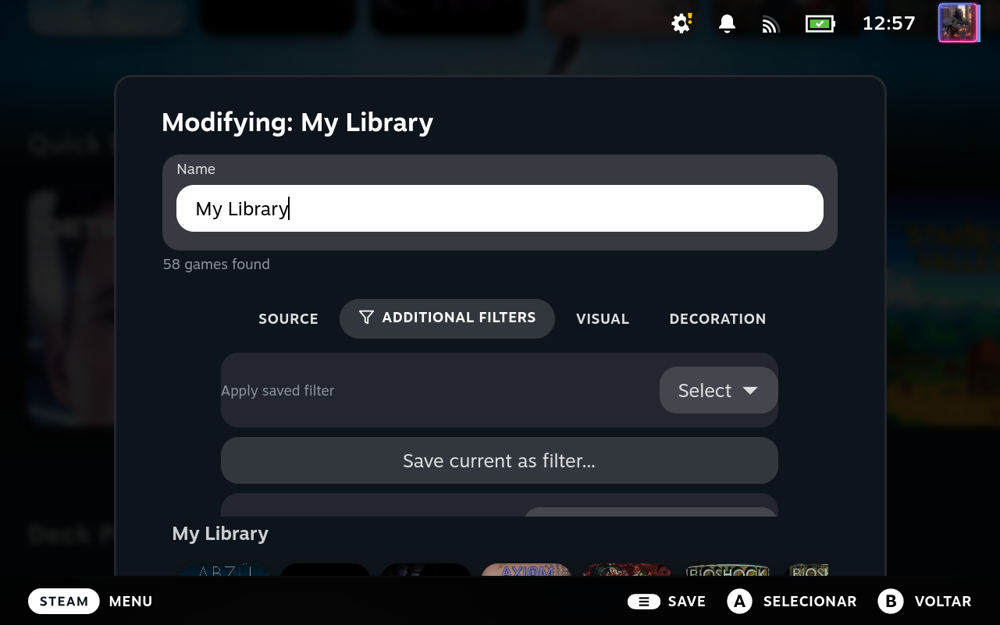

# Filter System

Deck Shelves supports advanced game filtering with AND/OR logic using filter groups.

<p align="center">
  
</p>

## How a shelf resolves

Filters are one stage of the pipeline that turns a shelf's configuration into
the cards on screen. Each stage below is optional except the source:

```mermaid
flowchart LR
    source["Source<br/>collection · tab · filter ·<br/>built-in · wishlist · store"]
    extra["Additional sources<br/>combined as union or intersection"]
    child["Child filter<br/>optional, narrows the pool"]
    group["Filter group<br/>AND / OR over filter items"]
    sort["Sort keys<br/>plus sortReverse"]
    limit["Limit"]
    out(["Shelf contents"])

    source --> extra
    extra --> child
    child --> group
    group --> sort
    sort --> limit
    limit --> out

    classDef src fill:#ede9fe,stroke:#7c3aed,color:#3b2a63
    classDef filt fill:#dbeafe,stroke:#2563eb,color:#12315e
    classDef ord fill:#fef3c7,stroke:#d97706,color:#5c3d0a
    classDef result fill:#dcfce7,stroke:#16a34a,stroke-width:2px,color:#14532d
    class source,extra src
    class child,group filt
    class sort,limit ord
    class out result
```



Every condition, sort key and built-in source below reads data the Steam client
holds, or data the plugin fetches when Online features are on. A shelf whose
saved configuration names something the plugin no longer evaluates (a condition
or sort key from an older version, or one that a plugin which is not running
registered) stays empty and is logged as unavailable; the editor shows that
condition as "Unavailable" with an X until it is changed. A query never widens
to the whole library because one of its parts is missing.

## Filter Types

| Type | Description | Parameters |
|------|-------------|------------|
| `installed` | Games currently installed | — |
| `favorites` | Games in your favorites | — |
| `nonSteam` | Non-Steam shortcuts (Epic, GOG, etc.) | — |
| `hidden` | Hidden games | `mode`: `"only"` or `"exclude"` |
| `updatePending` | Games with pending updates | — |
| `isNew` | Added to library within 14 days (older configurations only; not offered in the editor) | — |
| `deckCompatibility` | Steam Deck compatibility level | `levels`: `["verified", "playable", "unsupported", "unknown"]` |
| `steamosCompatibility` | SteamOS compatibility rating — distinct from Deck Compatibility (a different Valve rating, same 4-level scale) | `levels`: `["verified", "playable", "unsupported", "unknown"]` |
| `machineCompatibility` | Steam Machine compatibility rating (the living-room box; same 4-level scale) | `levels`: `["verified", "playable", "unsupported", "unknown"]` |
| `frameCompatibility` | Steam Frame compatibility rating (the VR headset; same 4-level scale) | `levels`: `["verified", "playable", "unsupported", "unknown"]` |
| `deviceCompatibility` | Compatibility rating **of the device you are on** — the Deck rating on a Steam Deck, the Machine rating on a Steam Machine, the Frame rating on a Steam Frame (Deck rating elsewhere). What the "Verified on this device" / "Playable on this device" templates use | `levels`: `["verified", "playable", "unsupported", "unknown"]` |
| `playedWithinDays` | Played within N days | `days`: number |
| `playtimeRange` | Total playtime in a range | `minHours`: number, `maxHours`: number (either optional) |
| `recentlyActive` | Played in the current session window | `minMinutes`: number |
| `neglected` | Played before, but not for N days | `days`: number |
| `playedOnce` | Played, but no more than N minutes | `maxMinutes`: number |
| `nameIncludes` | Name contains substring | `text`: string |
| `nameRegex` | Name matches regex | `pattern`: string |
| `collection` | Games in a specific Steam collection | `collectionId`: string |
| `developer` | Filter by developer name | `developers`: string[] |
| `publisher` | Filter by publisher name | `publishers`: string[] |
| `appIdList` | Explicit whitelist of app IDs | `appIds`: number[] |
| `cloudAvailable` | Steam Cloud support | — |
| `controllerSupport` | Native controller support | `min`: number (1 = partial or full, 2 = full only; default 1) |
| `shortcutType` | Filter by entry kind: game (Steam app_type 1 or unknown), software (app_type 2), tool (any other Steam app_type), demo, dlc, music, video, comic, guide, driver, config, hardware, beta, link (non-Steam shortcut) | `kinds`: string[] (default `["game"]`) |
| `systemCompatibility` | Runs natively / via compatibility layer | — |
| `remotePlayLocation` | Remote Play availability | `mode`: `"local"` \| `"local-only"` \| `"remote"` \| `"remote-only"` \| `"both"` |
| `libraryLocation` | Which Steam libraries the game is installed in — mix specific ones (an SD card + a USB drive, say) | `libraryIds`: string[] (device-specific library ids; empty = no restriction). Legacy saves without `libraryIds` fall back to `category`: `"internal"` \| `"external"` \| `"network"` |
| `installedSizeRange` | Installed size in a range | `minMB`, `maxMB`: number (the editor shows GB) |
| `appStatus` | Download / update activity | `groups`: `("downloading" \| "queued" \| …)[]` |
| `friendsPlayingNow` | Friends currently in-game | — |
| `friendsPlayedRecently` | Friends played within N days | `days`: number |
| `friends` | Owned by at least N of your friends _(needs Online features)_; `friends` narrows the count to those account ids | `min`: number, `friends`: number[] (optional) |
| `storeTag` | Carries the Steam Store tags, by name in the client's language or by tag id | `tags`: string[], `mode`: `"any"` \| `"all"` (default `"any"`) |
| `achievements` | Unlocked achievements in a range; a game with no achievements never matches | `min`, `max`: number (`max` omitted = no upper bound) |
| `discount` | Discount percentage range _(online)_ | `minDiscount`, `maxDiscount`: number |
| `priceRange` | Price range _(online)_ | `minPrice`, `maxPrice`: number (either optional) |
| `merge` | Nested predicate group with its own `and`/`or` mode (per-app boolean) | `mode`: `"and"` \| `"or"`, `items`: FilterItem[] |

`libraryLocation` reads Steam's own library records instead of guessing from the
install path — it also distinguishes network libraries and has a matching
"Library available" condition in Visibility Rules / profile triggers. The
editor shows one toggle per detected library (labelled, e.g. "SD_CARD",
"Steam", a NAS share's own label) rather than a category dropdown, so a
shelf can mix any combination — every external drive but not the network
share, say, or two specific SD cards but not a third.

### Store metadata

| Type | Description | Parameters |
|------|-------------|------------|
| `genres` | Any of the listed genres | `genres`: string[] |
| `categories` | Any of the listed store categories | `categories`: string[] |
| `franchise` | Franchise name contains | `franchise`: string |
| `vrSupport` | VR support level: VR-only titles, titles that support VR, or titles with no VR at all | `levels`: `("only" \| "supported" \| "none")[]` (default `["only", "supported"]`, which matches the old yes/no behavior) |
| `multiplayerType` | Multiplayer capability | `kind`: `"any"` \| `"single"` \| `"multi"` \| `"coop"` \| `"online"` |
| `reviewScore` | Review score meets a threshold | `value`: number (0–100), `op`: `">="` \| `"<="` (default `">="`), `source`: `"metacritic"` \| `"steam"` (default `"metacritic"`) |
| `releaseDate` | Released on or after / on or before a date, or with no release date | `ts`: number (Unix seconds), `op`: `"after"` \| `"before"` \| `"unknown"` (default `"after"`) |
| `purchaseDate` | Bought on or after / on or before a date, or with no purchase date | `ts`: number (Unix seconds), `op`: `"after"` \| `"before"` \| `"unknown"` (default `"after"`) |
| `storeCategory` | Carries the Steam features (store categories) the client records for the game, by category id; the editor names the ones Steam names | `ids`: number[], `mode`: `"any"` \| `"all"` (default `"any"`) |
| `comingSoon` | Not yet released (future release date) | — |

> **Where each of these reads its data:** `multiplayerType` and `vrSupport` read the Steam client's own local data for games you own — instant, works offline, no Online features needed. `reviewScore` reads the Steam review percentage and the metacritic score the client holds for your library; `releaseDate` and `comingSoon` read the release date the client holds. `genres`, `categories` and `franchise` have no local data, even for games in your own library, so they fetch and cache it (from the Store for genres and categories, from the Steam client's details cache for franchise) the first time such a filter runs — this needs Online features enabled, and on a large library the first resolve only covers part of the games, filling in the rest over the next few refreshes. All of these also work on wishlist/store cards you don't own yet.

### Progress and sharing

| Type | Description | Parameters |
|------|-------------|------------|
| `achievementPercentRange` | Achievement completion in a range | `min`, `max`: number (0–100) |
| `neverCompleted` | Has achievements, not all of them unlocked | — |
| `familySharing` | Borrowed through Steam Family Sharing | — |

The achievement conditions read the client's own achievement list for the Steam
games you have played; a game never played counts as having no progress.

### Tags

| Type | Description | Parameters |
|------|-------------|------------|
| `customTags` | Game carries any of your own tags (set them from the game menu: **Lists** → **Edit tags…**) | `tags`: string[] |
| `parserCategories` | Non-Steam shortcut carries any of the categories the tool that added it wrote (ROM managers and launcher integrations store them in Steam's shortcuts file) | `tags`: string[] |

### Composite conditions

These hold a list of conditions of any type in `children`, each evaluated like
a condition of the group, so ranges, name matches and the types above nest freely.

| Type | Description | Parameters |
|------|-------------|------------|
| `weightedFilter` | Matches when the summed weight of the matching children reaches `threshold`; with the default weight of 1 this reads as "at least N of these" | `children`: FilterItem[] (each may carry `weight`: number), `threshold`: number |
| `priorityFilter` | Matches when any child matches | `children`: FilterItem[] |
| `exclusionGroup` | Excludes the game when any child matches | `children`: FilterItem[] |

### Conditions from older versions

Versions before 3.4.2 offered conditions that read fields the Steam client
never had, or that duplicated a condition above. The duplicates are rewritten
when the settings load: `demo` becomes `shortcutType` with the demo kind,
`installedNeverPlayed` becomes installed with no playtime, `recentlyAbandoned`
becomes `neglected` plus `playedWithinDays`, `compatDataQuality` becomes
`deckCompatibility` without "unknown", and `hiddenLauncherShortcuts` becomes
non-Steam plus hidden. The others (DLC and soundtrack ownership, launch counts,
session length, storage device, executable type, launch option tags and the
launcher conditions) stay in the saved configuration as they are, and the
shelf that uses them is unavailable until the condition is changed.

## Filter Groups

Filters can be combined using groups with `AND` or `OR` logic:

```json
{
  "filterGroup": {
    "mode": "and",
    "items": [
      { "type": "installed", "params": {} },
      { "type": "deckCompatibility", "params": { "levels": ["verified", "playable"] } }
    ]
  },
  "sort": "recent"
}
```

Each item can be `inverted` to negate the condition:
```json
{ "type": "installed", "inverted": true, "params": {} }
```

> **Tip:** use `mode: "or"` when you want to surface games that match *any* of several conditions — for example, games by one developer **or** another. Use `mode: "and"` (the default) when every condition must hold simultaneously.

> **Tip:** `inverted` works on every filter type. Combine it with `mode: "and"` to exclude specific subsets — e.g. installed games that are *not* hidden.

### `merge` — nested predicate groups

`merge` lets a single filter item carry its own sub-group with an
independent `and`/`or` mode, so you can express more complex logic
without restructuring the parent group. It is **not** a list union —
the source pool stays the same and each app is tested once. Mixing a
top-level `and` group with a `merge { or, ... }` child is the usual
shape.

Example: include apps that are installed Steam games **or** any
non-Steam shortcut, in a single shelf:

```json
{
  "filterGroup": {
    "mode": "and",
    "items": [
      {
        "type": "merge",
        "params": {
          "mode": "or",
          "items": [
            { "type": "installed", "params": {} },
            { "type": "nonSteam", "params": {} }
          ]
        }
      }
    ]
  }
}
```

Each `appid` exists exactly once in the source pool, so the result
cannot contain duplicates regardless of how many merge children match
the same app. Cross-platform "same title, different appids" (e.g.
Steam vs. Epic copies) is **not** addressed here — `merge` does not
match by name.

## Sort Options

| Value | Description |
|-------|-------------|
| `alphabetical` | A → Z |
| `recent` | Last played (most recent first) |
| `playtime` | Total playtime (highest first) |
| `release_date` | Release date (newest first) |
| `size_on_disk` | Size on disk (largest first) |
| `metacritic` | Metacritic score (highest first) |
| `review_score` | Steam review score (highest first) |
| `added` | Library acquisition date (newest first) |
| `app_status` | Download / update activity |
| `deck_compat` | Steam Deck compatibility rating |
| `controller_support` | Controller support level |
| `friends_playing_now` | Friends currently playing (most first) |
| `owned_games` | Games already in your local library first |
| `completion_percent` | Achievement completion (highest first) |
| `closest_to_completion` | Nearest to 100% completion first; finished games last |
| `family_shared_games` | Games borrowed through Family Sharing first |
| `most_friends_owning` | Most friends who own it first _(needs Online features)_ |
| `trending_among_friends` | Friends playing now, then friends who own it _(needs Online features)_ |
| `price_low` | Price, lowest first _(online)_ |
| `discount_high` | Discount, highest first _(online)_ |
| `original_price_high` | Original price, highest first _(online)_ |
| `random` | Stable random shuffle, refreshes every 24 h |
| `source_order` | The order the source gives: pinned games last pinned first, play history newest first, the queues in queue order, a smart mode in its own ranking. On a multi-source shelf, each source in turn, each with its own sort |
| `manual` | User-defined order (`manualOrder`); ids not in the list fall through to `manualBaseSort` |

Every key can be inverted with `sortReverse`.

Sort keys from older versions that duplicated one of these are rewritten when
the settings load: `newest_purchased` to `added`, `largest_install` and
`smallest_install` to `size_on_disk`, `rediscovered_recently` and `most_ignored`
to `recent` (reversed where the old key was). The other old keys (launch
counts, session length, rarest achievements, install date, storage device and
the random variants) have no data behind them; a shelf still using one is
unavailable until its sort is changed.

### Multi-key sort

`sort` accepts either a single key (back-compat) or an array of keys for a primary/secondary chain. `sortReverse` mirrors the same shape — a boolean to invert every key, or an aligned `boolean[]` for per-key direction.

```json
{ "sort": ["discount_high", "metacritic"], "sortReverse": [false, false] }
```

The first entry is primary; subsequent entries break ties. Internally a single composite comparator walks each key in order until one returns a non-zero result, then JavaScript's stable sort preserves the established order across passes. Using `Array.sort().reverse()` per key would have inverted tied items and undone the secondary ordering — see `src/test/steam/applySortToIds.test.ts` for the pinned regression case.

`manual`, `random` and `source_order` cannot appear in a multi-key chain (non-deterministic — they wouldn't behave as tiebreakers). The editor only exposes them as the single-key primary choice; the resolver drops them from chained arrays.

Per-key `sortReverse` works for any key the multi-key path supports. When `sort` is an array and `sortReverse` is a boolean, the boolean applies to every key.

## Built-in sources

Besides a collection, library tab or filter, a shelf can draw from the client's
dynamic collections together or from one of the plugin's own game lists. Pick
**Built-in source** in the shelf editor and choose one; it is stored as
`{ "type": "builtin", "sourceId": "<id>" }` and takes no further parameters.

| Source | Contents |
|--------|----------|
| `dynamic_collections` | Every game in any of your dynamic collections (the ones Steam fills from a filter; a single collection is a collection source) |
| `pinned_games` | Games you pinned from the game menu, last pinned first |
| `history_source` | Play history, newest launch first (the last 100) |
| `session_queue_source` | The session queue in queue order, kept until Steam restarts |
| `temporary_queue_source` | The temporary queue in queue order; a game leaves it when you launch it |

Once a shelf, smart shelf, saved filter or profile uses one of them, every game
menu gains a **Lists** submenu that toggles the game in **Pinned games**, the
**Session queue** or the **Temporary queue**. **Play history** fills by itself.
These lists, and the custom tags, are stored on this device.

Three built-in sources from older versions are rewritten to the filter that
produces the same games when the settings load: the DLC and soundtrack sources
to `shortcutType`, the controller-specific source to `controllerSupport` with
full support. The others (followed and ignored games, recently updated, events,
workshop updates and the launcher libraries) are not offered any more; a shelf
still using one is unavailable until its source is changed.

## Collections

A collection shelf reads the collection by its id from the Steam client's own
collection store, and shows the games the collection holds at that moment: a
dynamic collection gives the games its filter selects, a static one the games
you put in it that are still in your library. The collection's name plays no
part, so two collections with similar names never mix. A collection the client
does not know (deleted, or from another account) leaves the shelf empty and is
logged as not found.

## Multi-source shelves

A shelf can stack multiple sources and combine their result sets. The editor exposes this implicitly: pick a primary source, then click **+ Add source** to stack extras. Single-source shelves persist their source flat (back-compat); two or more collapse into a `composite` source on save:

```json
{
  "source": {
    "type": "composite",
    "combine": "union",
    "sources": [
      { "type": "collection", "collectionId": "my-favorites" },
      { "type": "wishlist" },
      { "type": "tab", "tab": "installed" }
    ]
  }
}
```

Any source can be stacked: a collection, a library tab, a filter, a built-in
list, a smart mode, the wishlist, the store or a plugin's source. A smart mode
used as a source runs with its default parameters.

### Source order

With the shelf sorted by **Source order**, the sources follow each other in the
order they are listed, and each one can have its own sort (stored as `sort` and
`sortReverse` on the source; a source without one keeps its own order). For
example, pinned games first and then recently played games:

```json
{
  "sort": "source_order",
  "source": {
    "type": "composite",
    "combine": "union",
    "sources": [
      { "type": "builtin", "sourceId": "pinned_games" },
      { "type": "smart", "mode": "recently_played" }
    ]
  }
}
```

A collection by last session, a filter in random order and the wishlist by
biggest discount work the same way: give each source its sort. A game already
listed by an earlier source is not repeated.

### Combine operators

- `union` — games that appear in **any** child source, without repeats. Under **Source order** each source comes after the one before it; otherwise the sources take turns, one game each, and the shelf sort then orders the whole list.
- `intersection` — games that appear in **every** child source. Iteration order follows the first child, so users get a predictable primary ordering.

### Per-shelf exhaustion rules

A single shelf cannot stack two identical sources (e.g. *Collection A* + *Collection A*). The editor enforces this per-shelf via an exhaustion check:

- **wishlist / store** — capped at 1 per shelf. Once one is in the source list, the type disappears from the "+ Add source" dropdown for that shelf.
- **filter** — no cap; each filter is its own set of conditions.
- **tab / collection / built-in list / smart mode** — each one once per shelf. Once every option of a type is in use on this shelf, the type disappears.
- The same source CAN appear on multiple shelves — exhaustion is per-shelf, not global.

For multi-criteria predicates on a single source, use the [`merge` filter](#merge--nested-predicate-groups) instead of stacking multiple `filter` sources.

### Depth cap

Composite sources may nest (the schema permits it for power users editing JSON directly). The resolver caps recursion at 4 levels deep — beyond that the branch returns an empty result and logs a warning. The editor only exposes one level of nesting.

## Legacy Filter Format

## Importing from TabMaster

A TabMaster tab imports as a shelf whose conditions are the tab's filters under
the tab's own any/all mode, each mapped to the condition above that reads the
same data (TabMaster 3.1):

| TabMaster filter | Condition here |
|---|---|
| collection, installed, regex, whitelist, blacklist (negated), merge | `collection`, `installed`, `nameRegex`, `appIdList`, `appIdList` negated, `merge` |
| platform | `nonSteam`, negated for Steam |
| deck compatibility, steamos compatibility | `deckCompatibility`, `steamosCompatibility` |
| review score, time played, size on disk | `reviewScore`, `playtimeRange`, `installedSizeRange` |
| release date, purchase date (a day, month or year; days ago; unknown) | `releaseDate`, `purchaseDate` |
| last played (since / not since) | `playedWithinDays` / `neglected` |
| family sharing, demo, coming soon, streamable | `familySharing`, `shortcutType` (demo), `comingSoon`, `remotePlayLocation`, negated when the flag is off |
| steam features (any / all) | `storeCategory` with the same category ids |
| tags (any / all) | `storeTag` with the same tag ids |
| achievements (count or percentage, above / below) | `achievements` or `achievementPercentRange` |
| friends (any / all of the listed friends) | `friends` counting those friends |
| sd card, install folder | `libraryLocation` by the library's category (an SD card and a folder under `/run/media` are external) |

> **Note:** if you are importing shelves from a backup or from TabMaster, the conversion to the group format happens automatically — you do not need to migrate manually. A TabMaster filter with no equivalent here keeps its own name and imports as an unavailable condition, so the shelf is empty until you change it, instead of matching everything.

Older settings may use a flat filter format:
```json
{ "installed": true, "favorites": true, "sort": "alphabetical" }
```

These are automatically converted to the group format at runtime via `legacyFilterToGroup()`.

## Implementation

- Filter evaluation: `src/steam/filterEval.ts` → `evaluateFilterItem()`, `evaluateFilterGroup()`; the store-metadata and tag conditions in `src/steam/v3Extensions.ts`
- What makes a shelf unavailable: `src/steam/availability.ts`
- Rewrites of older ids: `src/domain/retired.ts`
- Filter UI: `src/components/conditions/ConditionEditor.tsx`
- Legacy conversion: `src/domain/settings.ts` → `legacyFilterToGroup()`
- Custom filter types: `src/domain/customfilters.ts`
