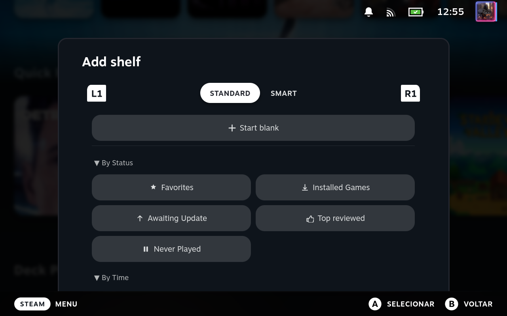

# Shelf Templates

Shelf templates are the presets in the picker you see when creating a shelf. Each has a predefined source (library tab or filter) and a suggested title; the shelf it creates can be renamed and edited like any other.

  

## Default shelves

When the user picks **Start with the default** at the end of the first-run tour, three shelves are created automatically:

| Template | Source |
|---|---|
| Favorites | Library tab `favorites` |
| Recently Played | Filter — sort by `recent` |
| Recently Added | Filter — sort by `added` |

## Setup packs and the setup wizard

The **Setup wizard** (the wand icon in the Quick Access menu's title bar, the first-run banner, and the end of the first-run tour) applies a whole starting point at once: pick a pack from the tiles, review exactly what it adds, apply. Every pack is a bundle of the templates below plus, where it helps, a few smart shelves and settings:

| Pack | Group | Adds |
|---|---|---|
| Essential | Quick setup | Favorites, Recently Played, Recently Added |
| Steam + non-Steam | Quick setup | Recently Played, Installed, Non-Steam, Favorites |
| Backlog rescue | Setup packs | Never Played + smart shelves *Backlog rescue* and *Best unplayed* |
| Portable Deck | Setup packs | Installed, Deck Verified + smart shelves *Short battery*, *Travel mode*, *Quick play* |
| Rediscover | Setup packs | Most Played + smart shelves *Rediscover*, *Forgotten gems*, *Hidden gems* |
| Living room | Setup packs | Favorites, Recently Played + smart shelves *Long session (night)*, *Deck picks*; turns on the same living-room look as the Machine pack: the first-shelf background art, hero art on every shelf, full-page shelves, the featured first game and logos |
| Frame | By device | VR games, VR only, Recently Played, Favorites + smart shelves *Quick play*, *Short battery* |
| Machine | By device | Favorites, Recently Played, Most Played + smart shelves *Long session (night)*, *Picks for this device*; turns on the first-shelf background art, hero art on every shelf, full-page shelves, the featured first game and logos |
| Stream | By device | Steam Cloud, Recently Played + smart shelf *Quick play* |

Packs are non-destructive: a template you already have is marked "already have" and skipped, nothing is removed, and every shelf stays editable afterwards. The wizard shows exactly what a pack will add before you apply it, marks packs that fit your library (from the same statistics as the Suggestions tab), and keeps one **Undo the last setup** step that removes only what the last apply added and restores the settings it changed.

---

## All available templates

### Favorites — `favorites`

**Source:** library tab `favorites`

Shows games the user has marked as favorites in the Steam library. Ordering follows Steam's own favorites list.

---

### Recently Played — `recent`

**Source:** filter — sort by `recent` (most recently played first)

Shows the most recently played games. Shelves from older versions that used a `recent` library tab are moved to this filter automatically when the plugin loads.

---

### Installed Games — `installed`

**Source:** library tab `installed`

Shows all games currently installed on the device.

---

### Most Played — `most_played`

**Source:** filter — `installed: true`, sort by `playtime` (descending)

Shows installed games ordered by total playtime. Only installed games are included so the list reflects what is playable right now.

---

### Recently Added — `recently_added`

**Source:** filter — sort by `added` (descending)

Shows games ordered by when they were added to the library, newest first. Includes all library games regardless of install state.

---

### Awaiting Update — `awaiting_update`

**Source:** filter — `installed: true`, `updatePending: true`, sort `alphabetical`

Shows installed games that have a pending update or download queued. Useful as a housekeeping shelf to track what needs downloading.

---

### Non-Steam / Emulators — `non_steam`

**Source:** filter — `nonSteam: true`, sort by `recent`

Shows non-Steam shortcuts (emulators, other launchers, manually added games) sorted by most recently played. The shelf is empty when no non-Steam entries exist.

---

### Long Sessions — `long_session`

**Source:** filter — `installed: true`, `minPlaytimeMinutes: 180`, sort by `playtime` (descending)

Shows installed games where the user has put in more than 3 hours — the titles they've genuinely committed to. Ordered by total playtime so the most-played entries surface first.

---

### Steam Cloud — `steam_cloud`

**Source:** filter — `filterGroup` containing `cloudAvailable`, sort `alphabetical`

Shows games with Steam Cloud support — saves sync across devices. Wraps `cloudAvailable` in a `filterGroup` because the field is not on the flat `ShelfFilter` schema.

---

### VR games — `vr_games`

**Source:** filter — `filterGroup` containing `vrSupport` with `levels: ["only", "supported"]`, sort `recent`

Every title that runs in VR, whether it requires a headset or merely supports one. The Frame setup pack starts from it.

### VR only — `vr_only`

**Source:** filter — `filterGroup` containing `vrSupport` with `levels: ["only"]`, sort `alphabetical`

Titles that require a headset.

### Verified on this device — `deck_verified`

**Source:** filter — `filterGroup` containing `deviceCompatibility=['verified']`, sort `alphabetical`

Shows games Valve rates *Verified* for the device you are on — the Deck rating on a Steam Deck, the Machine rating on a Steam Machine, the Frame rating on a Steam Frame. Like Steam Cloud, wraps the condition in a `filterGroup`.

---

### Top Reviewed — `top_reviewed`

**Source:** filter — `installed: true`, sort by `review_score` (highest first)

Shows installed games with the highest user review scores on Steam.

### Never Played — `never_played`

**Source:** filter — `maxPlaytimeMinutes: 0`, sort alphabetically

Your backlog: games you own but have never launched.

### Playable on this device — `deck_playable`

**Source:** filter — `deviceCompatibility: ["playable"]`, sort alphabetically

Pairs with *Verified on this device*, covering the *Playable* tier of the same per-device rating.

---

## Online templates

These appear in the picker only while online features are enabled, and resolve
over the network.

| Template | Id | Source | Default sort |
|---|---|---|---|
| Wishlist | `wishlist` | Your account's wishlist | — |
| Wishlist on Sale | `wishlist_on_sale` | Wishlist, discounted entries | `discount_high` |
| Free on Wishlist | `free_wishlist` | Wishlist entries that are free | `original_price_high` |
| Free Now | `free_now` | Currently free entries | `original_price_high` |

---

## Notes

> **Tip:** if none of the templates fit your use case, choose **Start blank** — it opens the edit modal directly so you can configure the source and filters from scratch without any preset defaults getting in the way.

- The template picker shows **Start blank** first, followed by all templates in a 2-column grid grouped by category (status / time / platform). Starting blank opens the Edit modal immediately.
- Tab-based templates (`favorites`, `installed`) take their order from Steam's own list; the sort option has no effect on them, only the limit applies.
- Every other template is filter-based and uses the plugin's own resolver and support all per-shelf display options (highlight first, match native size, hide game names, etc.).
- All templates produce fully editable shelves. Source type, sort order, limit, and display options can all be changed after creation.
